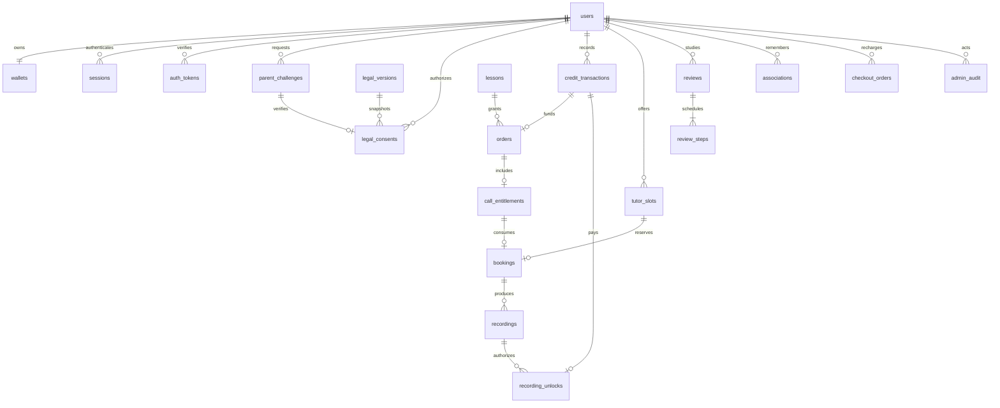

# Schema e invarianti

SQL esplicito con `pg`: i lock e i vincoli di concorrenza restano visibili nelle transazioni, senza dipendere dalla semantica implicita di un ORM. Ogni query parametrizza input utente. Le migrazioni sono versionate e atomiche; nessuna sincronizzazione automatica/distruttiva dello schema all’avvio.

`wallets.balance` è una proiezione aggiornata insieme al ledger append-only. Riconciliazione operativa: confrontare `wallets.balance` con `SUM(credit_transactions.delta)`; ogni differenza richiede indagine, mai correzioni dirette senza movimento. Stato minore derivato dalla data di nascita per evitare flag che diventano obsoleti al compleanno.

Confini delle transazioni: acquisto + ledger + entitlement; prenotazione + consumo entitlement + outbox; OTP + audit; settlement checkout + ledger. Nessuna chiamata Zoom, SMTP o S3 dentro transazioni con lock di business. Il video viene importato prima di pubblicare la disponibilità e addebitato solo allo sblocco, non al callback.

La consegna esterna non può essere exactly-once insieme a PostgreSQL. I retry del worker sono at-least-once, con deduplicazione di effetti e riconciliazione esplicita per POST Zoom ambiguo. Il processo conserva la causa operativa tramite job ID e categoria, non token o payload sensibili nei log.
