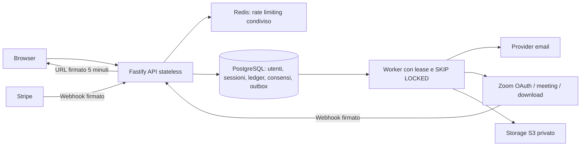

# Radice backend

Backend Node.js 24 / TypeScript, Fastify 5, PostgreSQL 17, Redis e storage S3. Include API, worker separato, backoffice HTML per amministratori e pagine di accesso/recupero password. Il frontend esistente, servito da questo backend, usa automaticamente le API reali; il sito statico GitHub Pages conserva la demo.

## Avvio locale, passo per passo

Servono Docker con Compose e Node.js 24 (solo per generare `.env`). Dalla radice del repository:

```sh
node backend/scripts/init-env.mjs
docker compose -f backend/compose.yaml up --build -d
```

Lo script genera segreti locali casuali in `backend/.env`, ignorato da Git; rifiuta di sovrascrivere un file esistente. Compose avvia PostgreSQL, Redis, S3 locale (LocalStack), Mailpit, migrazioni, API e worker. L’API ascolta sulla porta **3000**, il backoffice su **/admin**, accesso e recupero password su **/account**. Mailpit sulla porta **8025** permette di leggere le email locali (verifica account, OTP e reset). Il servizio S3 di sviluppo è sulla porta **9000**. Le porte di infrastruttura sono pubblicate solo sull’interfaccia locale.

1. Crea il tuo account dal frontend: nome, email, password di almeno 12 caratteri, data di nascita.
2. Apri l’email di verifica in Mailpit e conferma il link. Non esistono codici OTP fissi nel backend.
3. Accedi da `/account`. Per un minore, verifica anche il codice inviato al genitore; l’account può usare gli strumenti gratuiti, ma le call rimangono bloccate fino al consenso.
4. Per creare il primo amministratore, esegui una shell nel container:
   ```sh
   docker compose -f backend/compose.yaml exec api sh
   read -r -p 'Email amministratore: ' ADMIN_EMAIL
   export ADMIN_EMAIL
   stty -echo
   read -r -p 'Password (almeno 12 caratteri): ' ADMIN_PASSWORD
   stty echo
   export ADMIN_PASSWORD
   node dist/create-admin.js
   unset ADMIN_PASSWORD ADMIN_EMAIL
   exit
   ```
   Nessun account amministratore o password predefinita viene creato. Il comando non sovrascrive account esistenti. L’email admin è verificata perché il bootstrap è eseguito dall’operatore.
5. Accedi a `/admin`: cerca persone, modifica ruolo/accesso, assegna l’ID Zoom del tutor, consulta consensi, registra rettifiche di credito con motivazione e invia recuperi password. Non è possibile vedere o scegliere la password di un altro utente.

In locale, S3 è un **emulatore**: non usarlo per dati reali né come prova delle policy IAM di produzione. I dati PostgreSQL e Redis sono su volumi; gli oggetti S3 locali sono effimeri al riavvio del container. Mailpit non invia email su Internet. Non usare `docker compose down -v` se vuoi conservare il database.

## Sviluppo senza container applicativo

```sh
cd backend
npm ci
docker compose up -d postgres redis s3 mailpit
node scripts/local.mjs npm run migrate
node scripts/local.mjs npm run dev
# In un secondo terminale:
node scripts/local.mjs npx tsx src/worker.ts
```

`local.mjs` carica i segreti senza stamparli e collega i processi alle dipendenze Docker. Il frontend non richiede build; il backend si compila con `npm run build`. In ambienti con home non scrivibile usare `npm ci --cache /tmp/radice-npm-cache` e `BUILDX_CONFIG=/tmp/radice-buildx docker compose build`.

## Architettura e garanzie



- **Sessioni opache**: token casuale da 256 bit in cookie HttpOnly, SameSite=Strict, Secure in produzione; solo hash nel DB, scadenza 12 ore e revoca immediata. Password scrypt (N=32768, r=8, p=3) con salt casuale. Origin esatta + token CSRF su mutazioni autenticate, CORS ristretto, CSP, no-store sulle API. Nessun token di sessione in localStorage.
- **Ruoli**: registrazione pubblica crea solo STUDENT; ruoli TUTOR/ADMIN assegnati dal backoffice. Il tutor può pubblicare disponibilità e leggere le proprie prenotazioni; lo studente può leggere solo i propri dati.
- **Consenso**: età calcolata server-side dalla data di nascita. OTP casuale, HMAC con pepper, massimo 5 tentativi, 10 minuti, uso singolo. La verifica salva testo e versione, studente, genitore/CF/email cifrati AES-256-GCM, IP, User-Agent e `timestamptz`. `DATA_KEY` va conservata in un secret manager e nel piano di recovery; cambiarla senza migrazione rende illeggibili i dati cifrati.
- **Immutabilità**: trigger PostgreSQL impediscono UPDATE, DELETE e TRUNCATE su ledger, audit admin, consensi e versioni legali. In produzione il ruolo applicativo deve essere diverso dal proprietario delle tabelle, senza privilegi DDL; applicare `scripts/grants.sql` dopo le migrazioni. Il superuser del DB può comunque alterare i dati: per requisiti probatori superiori esportare periodicamente gli audit su storage WORM/Object Lock con retention approvata.
- **Crediti**: lock `FOR UPDATE` sul portafoglio; controllo saldo, aggiornamento e ledger nella stessa transazione. Unicità `(user_id,idempotency_key)` impedisce doppi addebiti; una chiave riusata con importo/riferimento differente produce 409. Prezzi server: 8, 15 e 3 crediti. Ricariche mai accreditate dal client o dalla pagina di ritorno Stripe.
- **Prenotazioni**: vincolo PostgreSQL di esclusione sugli intervalli tutor, slot prenotabile una sola volta, entitlement consumato atomicamente; consenso corrente obbligatorio per minori. La richiesta restituisce 202/PROVISIONING, non un meeting già pronto.
- **Outbox**: email, meeting e import video sono accodati nella transazione di business; payload cifrati, worker con lease, heartbeat e `SKIP LOCKED`, retry esponenziale, 8 tentativi e stato FAILED visibile nel backoffice. Invio email *at least once*: un crash può duplicare un’email, non creare nuovi crediti o nuovi consensi. Payload eliminati a completamento.
- **Registrazioni**: firma webhook e finestra anti-replay di 5 minuti, account Zoom verificato, deduplica eventi; download in streaming (massimo 2 GiB, timeout 15 minuti), oggetti privati, URL firmato di 300 secondi solo dopo autorizzazione. Il link rimane utilizzabile fino a scadenza: non è DRM e non impedisce la copia da parte dell’utente autorizzato.
- **Immagini**: limite multipart 200 KiB, un file, riconoscimento e decodifica effettiva Sharp, no SVG/animazioni, limite 16 megapixel, orientamento e ricodifica WebP senza metadati. Il tipo dichiarato dal browser non è considerato affidabile.

## Zoom: configurazione obbligatoria

1. Crea un’app **Server-to-Server OAuth** nel tuo account Zoom e abilitala. Ogni tutor deve essere un utente host dello stesso account con licenza e cloud recording attivo.
2. Configura `ZOOM_ACCOUNT_ID`, `ZOOM_CLIENT_ID`, `ZOOM_CLIENT_SECRET`, `ZOOM_WEBHOOK_SECRET` nei segreti del provider. Non usare le credenziali della piattaforma frontend.
3. Concedi gli scope necessari per creare/leggere/elencare meeting degli utenti e leggere/scaricare registrazioni cloud. Verifica i nomi granulari nella console Zoom corrente (meeting write/read/list amministrativi e cloud recording read). Il codice usa `/users/{id}/meetings`, `/meetings/{id}`, OAuth account_credentials e download recording.
4. Registra l’endpoint HTTPS `/api/v1/webhooks/zoom` e l’evento `recording.completed`. Il backend risponde anche alla challenge `endpoint.url_validation` firmata.
5. Nel backoffice imposta `zoomUserId` del tutor. Crea slot con `POST /api/v1/tutor/slots` autenticato come tutor, oppure come ADMIN indicando `tutorId`.
6. La creazione imposta `auto_recording: "cloud"`, `join_before_host: false` e waiting room; legge nuovamente il meeting e non espone il link se i due vincoli obbligatori non sono effettivi. Il tutor avvia il meeting dal proprio account Zoom; nessun `start_url` privilegiato è esposto allo studente.
7. Esegui una vera lezione di collaudo: ingresso host, ingresso studente, fine meeting, callback e riproduzione dal bucket. I test automatici verificano i contratti locali, **non** certificano account/scopes/cloud recording di un account reale.

**Limite del provider:** queste impostazioni avviano automaticamente la registrazione quando l’host avvia la sessione, ma non garantiscono tecnicamente “ogni istante” né impediscono a un host autorizzato di sospenderla. Servono policy account che blocchino le modifiche dove disponibili, formazione tutor, monitoraggio eventi e verifica contrattuale del servizio. Il solo frontend/backend non può fornire questa garanzia assoluta.

In caso di timeout ambiguo alla creazione, il worker cerca un meeting con il riferimento univoco della prenotazione; non ripete ciecamente il POST. Se non riesce a riconciliarlo marca ACTION_REQUIRED. L’operatore controlla Zoom prima del retry. Se è accertato che nessun meeting è stato creato, un operatore DB può azzerare `creation_started_at` per quella prenotazione e ripetere il job, registrando l’intervento operativo. Il worker ammette download HTTPS esclusivamente su `zoom.us` e sottodomini; eventuali redirect verso CDN differenti sono rifiutati e devono essere aggiunti solo dopo verifica delle destinazioni ufficiali.

## Email, pagamenti e video delle lezioni

Produzione: SMTP verificato (TLS, dominio autenticato SPF/DKIM/DMARC). Verifica email e password reset usano link monouso di 30 minuti; il consenso del tutore usa un’email distinta e non equivale a verifica documentale dell’identità del genitore. Il CF viene controllato sintatticamente e tramite checksum, non tramite banca dati fiscale.

Stripe è predisposto tramite `STRIPE_SECRET_KEY` e `STRIPE_WEBHOOK_SECRET`. Webhook HTTPS `/api/v1/webhooks/stripe`: `checkout.session.completed`, `checkout.session.async_payment_succeeded`. Prezzi: 15/30/50/100 crediti → 1500/2800/4500/8500 centesimi EUR. Il settlement controlla importo, valuta, ordine, utente e sessione ed è idempotente. Configurare inizialmente chiavi test; aspetti fiscali, rimborsi/dispute e prezzi finali richiedono regole commerciali deliberate, non sono automatizzati qui.

Carica i video didattici nel bucket privato sotto `lessons/...mp4` e associa la chiave tramite `PATCH /api/v1/admin/lessons/:id`. I video non sono inclusi nel repository. `GET /lessons/:id/video` autorizza intro gratuita o acquisto precedente. Non usare URL pubblici permanenti.

## Deploy Render / Railway

**GitHub Pages non esegue questo backend.** Serve un servizio Node/Docker con PostgreSQL, Redis e un worker.

1. Collega il repository a Render o Railway. Imposta Dockerfile `backend/Dockerfile` e contesto build alla radice del repository.
2. Crea PostgreSQL gestito e Redis gestito, preferibilmente nella stessa regione; usa connessioni private e TLS verificato. Non usare `rejectUnauthorized:false`. Configura trust store/CA del provider se necessario.
3. Crea un bucket S3 privato nella regione scelta, blocca l’accesso pubblico, configura cifratura, lifecycle/retention e IAM minimo per soli prefissi necessari. Le credenziali possono venire da IAM role; per S3 compatibile imposta endpoint e credenziali. S3 deve essere raggiungibile dai browser tramite gli URL firmati.
4. Inserisci le variabili di `.env.example` nel secret manager. Imposta `NODE_ENV=production`, `APP_ORIGIN=https://tuo-dominio`, `COOKIE_SECURE=true`. `TRUST_PROXY` deve contenere solo IP/CIDR reali del proxy del provider; una configurazione permissiva permette spoofing dell’IP di audit e dei limiti.
5. Esegui una volta `node dist/migrate.js` come pre-deploy/release job con credenziali del proprietario schema. Le migrazioni sono serializzate via advisory lock. In produzione separa le credenziali migrator dalle credenziali API/worker e applica `scripts/grants.sql` con il nome del ruolo applicativo. Se il piano non offre pre-deploy, usa un job dedicato prima di attivare nuove repliche.
6. Servizio web: `node dist/server.js`, porta dalla variabile `PORT`; health check `/health/ready`.
7. Servizio worker separato, stessa immagine, comando `node dist/worker.js`, stessi segreti e accesso DB/storage/SMTP/Zoom. Non avviarlo dentro ogni replica web.
8. Crea il primo admin con `node dist/create-admin.js` dalla console sicura del provider impostando temporaneamente `ADMIN_EMAIL` e `ADMIN_PASSWORD`; rimuovile subito dopo.
9. Configura DNS/HTTPS, callback Zoom e Stripe, collauda il flusso completo con account test prima del traffico reale. Pubblicare l’ambiente Codex non equivale a fare questo deploy.

Per mantenere cookie e CSRF semplici, il container serve anche il frontend sullo stesso dominio. Se separi frontend e API, devi rivedere esplicitamente dominio cookie, CORS, CSP e origine dei form; non usare wildcard con credenziali.

## API essenziali

Prefisso `/api/v1`. JSON salvo multipart. Mutazioni autenticate: cookie `radice_session`, header `Origin` e `X-CSRF-Token` ottenuto da login/session. `Idempotency-Key` (16–128 caratteri) obbligatorio per ordini, prenotazioni, checkout e rettifiche admin. Il chiamante deve riusare la **stessa** chiave quando ritenta la stessa operazione dopo un errore di rete.

| API | Funzione |
| --- | --- |
| POST /registrations | Registrazione STUDENT; `password`, email, nome/cognome, birthDate, privacy; minori: dati tutore, parentConsent, legalVersion |
| GET /legal/parent | Versione e testo corrente da mostrare prima del consenso |
| POST /registrations/:id/verify-parent | `{code}`; id è l’ID challenge ricevuto |
| POST /consents/request | Utente autenticato: `{guardian:{firstName,lastName,email,taxCode},accepted:true,legalVersion}` |
| POST /auth/login; GET /auth/session; POST /auth/logout | Sessioni e token CSRF |
| POST /auth/forgot-password; /auth/reset-password; /auth/verify-email; /auth/resend-verification | Recupero e verifica email |
| GET /me/dashboard; /me/credits | Dati personali, ultimi 50 elementi / 100 movimenti |
| POST /reviews; PATCH /reviews/:id/steps/:index | Ripassi +1/+7/+30/+90 giorni di calendario |
| POST /associations | multipart `number`, `word`, `image` opzionale ≤200 KiB |
| GET /lessons; /lessons/introduction; /lessons/:id/video | Catalogo e riproduzione autorizzata |
| POST /orders | `{product:'single'|'bundle',topic}` → orderId, balance |
| GET /tutors; GET /availability?tutor=UUID&date=YYYY-MM-DD | Tutor configurati e orari Europe/Rome |
| POST /tutor/slots; GET /tutor/bookings | Slot ISO con offset e agenda tutor |
| POST /bookings | `{tutor,date,time,timezone:'Europe/Rome',recordingConsent:true}` → 202 |
| GET /recordings; POST /recordings/:id/unlock | Archivio autorizzato e URL firmato |
| POST /checkout; POST /webhooks/stripe | Pagamenti e accrediti verificati |
| POST /webhooks/zoom | Eventi Zoom firmati e deduplicati |
| GET /admin/users?search=…&after=UUID | Ricerca per prefisso e paginazione 50 utenti |
| PATCH /admin/users/:id | role, disabled, zoomUserId e reason |
| POST /admin/users/:id/credits | Variazione `delta` con reason, audit e idempotenza |
| POST /admin/users/:id/password-reset | Invio reset e revoca sessioni; reason |
| GET /admin/users/:id/consents; /admin/users/:id/credits | Consensi cifrati decifrati per admin e ledger |
| GET /admin/operations; POST /admin/jobs/:id/retry | Errori operativi e ripetizione motivata |
| PATCH /admin/lessons/:id | storageKey privata + reason |

Risposte: 400 dati non validi, 401 sessione assente, 403 ruolo/CSRF/consenso, 404 risorsa non posseduta, 409 saldo o conflitto, 413 file eccessivo, 429 limite richieste, 503 integrazione non configurata. Nessun segreto o stack trace nei messaggi API.

## Test e limiti di capacità

```sh
cd backend
npm ci
docker compose up -d postgres redis s3 mailpit
docker compose exec -T postgres createdb -U radice radice_test
node scripts/local.mjs --test npm run migrate
node scripts/local.mjs --test npm test
npm run build
```

`createdb` si esegue solo alla prima creazione. I test rifiutano database il cui nome non termina in `_test`. Usano PostgreSQL e Redis veri, utenti isolati, test di concorrenza e firme; nessuna chiamata Zoom o pagamento reale. Non cancellano le tabelle di audit fra esecuzioni.

L’architettura permette repliche API e worker e non richiede session affinity. **Milioni di utenti non sono una capacità certificata da questi test.** Prima di quel volume servono load test su workload reale, SLO e capacity planning; dimensionare connessioni totali (`repliche × DB_POOL_MAX`), PgBouncer, backup/PITR e restore test, Redis HA, coda/dead-letter alerting, quote Zoom/SMTP/Stripe, CDN privata, osservabilità e rotazione chiavi. Per la crescita degli audit valutare partizionamento temporale, indici e retention legale. Il dashboard mostra gli ultimi 50 elementi; per archivi personali estesi aggiungere navigazione paginata dedicata. Il numero di utenti non giustifica da solo sharding o microservizi prematuri.

Il reset password, la disabilitazione e la modifica ruolo revocano le sessioni. Mancano volutamente automazioni per cancellazioni/cancellazione account che possano violare audit o retention: vanno progettate con le policy legali. MFA per amministratori, allarmi sui privilegi, verifiche di identità tutore e retention delle registrazioni devono essere definiti prima di un rilascio con dati reali di minori.

## Verifica eseguita e integrazioni esterne

Build TypeScript e immagine Docker verificate nell’ambiente di sviluppo. Test su PostgreSQL/Redis reali e S3 locale; prova browser di registrazione, consegna email via worker/Mailpit, verifica, login, ripassi, immagini e rettifica crediti ADMIN. Le prove locali non sostituiscono un test con account Zoom/Stripe e bucket IAM di produzione.

La pipeline `.github/workflows/backend.yml` ripete build, formattazione, test d’integrazione e controllo dipendenze su GitHub Actions; non è stata eseguita sul servizio GitHub in questa sessione. I valori presenti nella pipeline sono esclusivamente fixture usa e getta.

In reti aziendali con CA aggiuntiva, il Dockerfile supporta un certificato montato solo durante la build, senza disabilitare TLS né includerlo nell’immagine finale:

```sh
docker build --secret id=custom_ca,src=/percorso/ca-aziendale.crt -f backend/Dockerfile -t radice-backend:local .
docker compose -f backend/compose.yaml up -d --no-build
```
